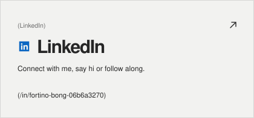
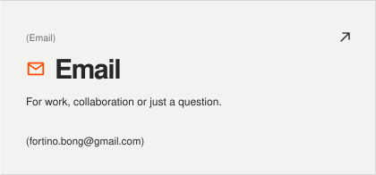

<!-- readme-atelier:start -->
<!-- Generated by scripts/build.mjs with Readme Atelier. Edit atelier.yml instead of this block. -->

<picture><source media="(prefers-color-scheme: dark)" srcset="./atelier/profile-header-dark.svg"/></picture> <a href="https://www.linkedin.com/in/fortino-bong-06b6a3270"><picture><source media="(prefers-color-scheme: dark)" srcset="./atelier/contact-linkedin-dark.svg"/></picture></a><a href="mailto:fortino.bong@gmail.com"><picture><source media="(prefers-color-scheme: dark)" srcset="./atelier/contact-email-dark.svg"/></picture></a> <picture><source media="(prefers-color-scheme: dark)" srcset="./atelier/profile-dark.svg"/></picture>

<!-- readme-atelier:end -->
